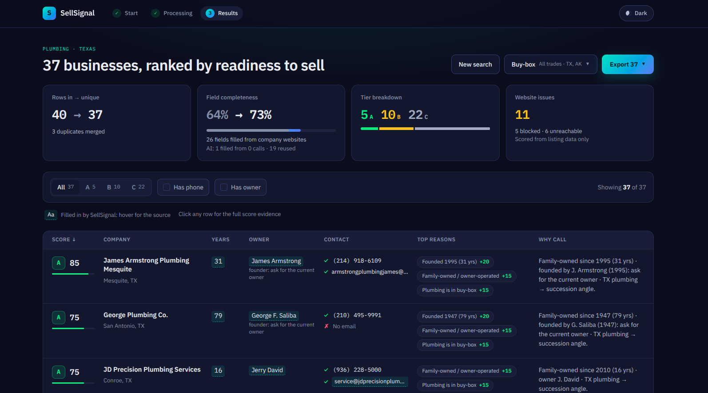
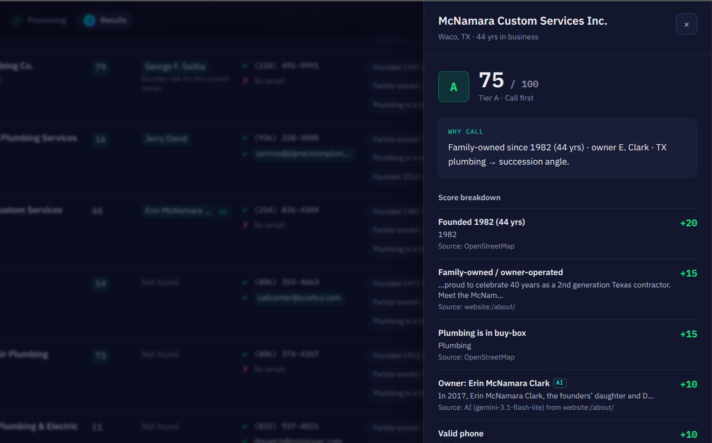

# SellSignal

**SaaSquatch tells you who matches your keywords. SellSignal tells you who's likely to sell, and shows you why.**

- **Live demo:** https://sell-signal-app.netlify.app/
- **Video walkthrough:** https://drive.google.com/file/d/1zehfjSmO4z1ZBUD8zi_sZgmgiT9CkeKq/view?usp=sharing





---

## The problem

**Who uses this.** Acquisition searchers look for small, owner-run businesses to buy. Callers work through those lists by phone. Both have far more leads than time to call them.

**Why ranking matters.** A long list of HVAC or plumbing companies is easy to get. The hard part is knowing who to call first. That depends on seller signals: how long the business has existed, whether it is family-owned, whether an owner can be reached, and whether it is already owned by a franchise or a fund.

**SaaSquatch today.** SaaSquatch (the reference lead-generation tool) is strong at finding companies, building lists and enriching them in one place. Its AI Company Scoring ranks companies by how well their websites match the positive and negative keywords you type in.

Testing the free tier showed three gaps for this use case:

- Many enriched fields came back as N/A.
- The revenue estimate failed with an error ("All Gemini models failed"), and the owner lookup returned an error.
- The score measures keyword fit. It has no "will they sell?" signal, so it can't tell a caller who to call first.

SellSignal is meant to sit **next to** SaaSquatch, not replace it. It takes a SaaSquatch CSV export (or finds its own leads) and adds the seller-side view.

## What it does (the one feature)

SellSignal upgrades company scoring into an **Acquisition Readiness Score**:

- **0–100**, sorted into tiers **A** (call first), **B** (nurture) and **C** (low priority).
- **Evidence for every point.** Each point is a reason with a label, a quote and a source, e.g. *Founded 2010 · "Founded in Conroe, TX in 2010" · website:/about-us/*.
- **A why-call line** for the caller, built from a template (no LLM), e.g. *Family-owned since 2010 (16 yrs) · owner J. David · TX plumbing → succession angle.*

Finding, cleaning, merging and enriching leads is how the score becomes trustworthy. They are not separate features.

## How to use it

1. **Start.** Pick a trade and a US state and press **Find**. Or switch to **Import CSV** and drop a SaaSquatch export (or any CSV with a company column), or press **Use sample file**.
2. **Processing.** A progress bar and live counters show rows read, duplicates merged, fields filled and site issues. A typical run of about 40 companies takes 1–2 minutes. You can cancel, and a reload resumes the run.
3. **Results.**
   - **Report cards:** rows in → unique, field completeness before → after, A/B/C counts, website issues.
   - **Filters:** tier, has phone, has owner, state. Filters live in the URL, so a link keeps them.
   - **Table** (desktop) or **cards with a Call button** (phone). Highlighted values were filled in by SellSignal; hover one to see its source.
   - **Evidence drawer:** click any row to see the full score breakdown, contact details with their checks, and where each value came from. Values from the optional AI fallback carry an **AI** tag.
   - **Buy-box:** choose which trades and states count as a fit and press **Rescore**. Scores, tiers and the call order update from the data already collected, without visiting any website again.
   - **Export** (uses the current filters):
     - **CSV:** every column, score, reasons and sources.
     - **Call sheet:** tiers A and B only, best first, with the why-call line and empty *Outcome / Notes / Follow-up date* columns for the caller.
     - **HubSpot CSV:** columns named after HubSpot's default company properties, so the import needs no manual mapping.

## How it works

**Pipeline:** sources → normalize → dedupe and merge → website enrichment → validation → score → report → export.

```mermaid
flowchart LR
  U["Searcher / caller<br/>(browser)"] --> FE["React + Vite + Tailwind<br/>static site · Netlify"]
  FE -->|"REST · polls every 2 s"| API["Express + TypeScript API<br/>long-running service · Railway"]

  subgraph Sources["Source adapters"]
    OSM["OpenStreetMap Overpass<br/>(retry → mirror)"]
    CSV["SaaSquatch-format CSV"]
    SEED["Seed list<br/>(fallback)"]
  end

  API --> Sources
  Sources --> N["Normalize<br/>domain · phone · name · state"]
  N --> D["Dedupe + merge<br/>domain | phone | name + city"]
  D --> J["Enrichment job<br/>in-process · 5 sites at a time"]

  J --> C{"domain_cache<br/>fresh?"}
  C -->|hit| X
  C -->|miss| R["robots.txt check"]
  R --> W["Company website<br/>home + about + contact<br/>8 s timeout · 1 retry"]
  W -->|"403 / 429 / CAPTCHA"| B["mark blocked<br/>(never bypassed)"]
  W --> X["Extract facts<br/>JSON-LD → microdata → text"]

  X -.->|"owner or year missing<br/>(optional)"| AI["AI fallback · Gemini<br/>quotes checked against the page"]
  AI -.-> V
  X --> V["Validate<br/>US phone · email domain MX · state"]
  V --> S["Score 0–100 · tier A/B/C<br/>reasons + why-call line"]

  S --> DB[("PostgreSQL · Neon<br/>runs · leads · domain_cache")]
  J --> DB
  C --- DB

  API -->|"report · leads · filters"| FE
  API -->|"CSV · call sheet · HubSpot CSV"| U
```



(The same diagram is in [`docs/architecture-diagram.png`](docs/architecture-diagram.png).)

**One lead, end to end** (from a live *Plumbing · Texas* run):

1. **Source.** OpenStreetMap returns *JD Precision Plumbing Services*, `craft=plumber`, website `https://www.jdprecisionplumbing.com/`, phone `+1-936-228-5000`, Conroe TX.
2. **Normalize.** Website → root domain `jdprecisionplumbing.com`. Phone → `9362285000`. Name → `jd precision plumbing services` for matching.
3. **Dedupe.** It is compared with every other row by root domain, phone, and name + city; any match would be merged into one lead.
4. **Enrich.** robots.txt allows us. We read `/`, `/about-us/` and `/contact-us/`. The text rules find *"Founded in Conroe, TX in 2010"*, *"Owner Jerry David"* and *"a family-owned and operated company"*, plus an email address. Only empty fields are filled; the OpenStreetMap phone is kept.
5. **Validate.** The phone is a valid US number. The email's domain has MX records, so it **accepts email**.
6. **Score.** Family-owned +15, plumbing in buy-box +15, founded 2010 (10–19 yrs) +10, owner named +10, valid phone +10, domain accepts email +10, TX in buy-box +5 = **75 → tier A**.
7. **Why-call.** *Family-owned since 2010 (16 yrs) · owner J. David · TX plumbing → succession angle.*
8. **Export.** It appears in the call sheet with the phone, the owner and the line above.

## Scoring

Every point comes from one of these signals. There are no baseline points.

| Signal | Points |
|---|---|
| In business 20+ years | +20 |
| In business 10–19 years | +10 |
| Family-owned / locally owned / owner-operated / "Nth generation" | +15 |
| Industry is in the buy-box | +15 |
| Owner or founder name found | +10 |
| Valid US phone | +10 |
| Email domain accepts email (MX records) | +10 |
| Dated website: © year ≤ 2021, or no mobile viewport, or no HTTPS | +10 |
| State is in the buy-box | +5 |
| Franchise / subsidiary / PE- or portfolio-owned / "acquired by" | −30 |
| Nonprofit or public (`.gov`, `.edu`, "non-profit", "501(c)") | −40 |
| Website blocked, unreachable or disallowed by robots.txt | 0 (shown as a flag) |

- The total is clamped to 0–100. **A ≥ 70 · B 45–69 · C < 45.**
- **Not-a-fit cap.** A lead with a franchise/PE or nonprofit signal is **tier C whatever its score**, so it never reaches the call sheet. Besides website wording, a company name that matches a known franchise brand (e.g. Benjamin Franklin Plumbing, Mr. Rooter, One Hour Heating & Air, Kinetico) counts as the franchise signal.
- **Founder vs owner.** Names found as "Owner", "President", "CEO" or "owned and operated by" are **owners**. Names found as "Founder" or "founded/started/established by" are **founders**. Both earn +10, but a founder's why-call says *"founded by G. Saliba (1947): ask for the current owner"*, because the founder may have retired or sold.
- **Buy-box.** By default the buy-box is all four trades plus the searched state (discovery) or every state in the file (CSV). **In discovery mode every lead gets the industry (+15) and state (+5) points**, so the ranking within a run comes from the other signals. Change the trades and states with the **Buy-box** button on the results page (weights too, through `PUT /api/runs/:id/buybox`). Rescoring reuses the stored signals and visits no website again.
- **These are proxies, not predictions.** A high score means "worth a call", not "will sell".

### AI fallback (optional, off by default)

Rules find the facts first. When they leave the **owner name or the founding year** empty on a site that was read, SellSignal can ask Gemini (`gemini-3.1-flash-lite`) once about that site's page text.

- **One call per site** returns the owner (and whether they own it now or founded it), the founding year and whether it is family-owned. Each value must come with the exact sentence it was taken from.
- **Grounding guard.** A value is kept only if:
  - its sentence appears word for word on a fetched page, and the value appears in that sentence;
  - an owner is a real first and last name, and is called a founder only if the sentence says they started the business (someone who *"purchased the company"* is the owner);
  - a year passes the same 1900…current-year rule as the text rules and doesn't come from a © line;
  - family-owned is said in family words.

  Everything else is thrown out and counted as rejected.
- **Fills gaps only.** Values from the rules or the source data are never replaced. AI values carry the source `AI (gemini-3.1-flash-lite) from website:/about/` and an **AI** tag in the table and drawer, and score like any other value.
- **Limits.** At most 25 calls per run, spaced to 15 requests per minute (Gemini's free tier). A provider error skips that site; a rate-limit or quota error stops the AI pass for the run. Either way the rules-only result stands.
- **Cached** with the site in `domain_cache`, so a repeat search makes no AI calls.

**Measured** on the same *Plumbing · Texas* search: 19 sites were sent (the rules had missed the owner or year on each).

| | Without AI | With AI |
|---|---|---|
| AI calls | — | 19 (0 when run again) |
| Values filled by AI | — | 1 owner |
| Suggestions rejected by the guard | — | 2 |
| Owner fill rate | 14% | 16% |
| Completeness after enrichment | 72% | 73% |

- **The fill:** *Erin McNamara Clark*, from *"In 2017, Erin McNamara Clark, the founders' daughter and Daniel Thompson purchased the company."* The rules don't catch "purchased the company".
- **The two rejections were right:** a first name only (*"Brittney"*), and a founding year of 1892, which is outside the allowed range.
- **On the rest, the AI returned nothing usable:** most of these sites don't name an owner. The guard trades recall for trust.

## Data sources

### OpenStreetMap (discovery)
SellSignal queries the free Overpass API for businesses of one trade, with a website, in one state. Each trade was checked with a live count of Texas businesses that have a website:

| Trade | OSM tag | Texas results with a website | Kept |
|---|---|---|---|
| HVAC | `craft=hvac` | 132 | ✅ |
| Plumbing | `craft=plumber` | 74 | ✅ |
| Electrical | `craft=electrician` | 35 | ✅ |
| Roofing | `craft=roofer` | 109 | ✅ |
| Landscaping | `craft=gardener` (`craft=landscaper` had 0) | 20 | ❌ too few |
| Pest control | `craft=` / `office=` / `shop=pest_control` | about 16 combined | ❌ too few |

Landscaping and Pest control were dropped because even Texas, a large state, had too few listings to make a useful run. Each discovery run is capped at 40 companies.

### CSV import (SaaSquatch format)
- Accepts SaaSquatch's export columns, and any CSV with a company column. Up to 200 rows; about 50 is recommended.
- Headers match **case-insensitively, with aliases**: e.g. `Company` / `company` / `Company Name`, `Company Phone` / `companyPhone` / `phone`, `State/Region`, `Year Founded`, `Owner/Founder`.
- `N/A`, `NaN`, `null`, `-` and empty cells count as missing.

### Company websites (enrichment)
For each company we read at most three pages: the homepage and the about-like and contact-like pages linked from it. Each field is extracted in layers, and the first hit wins:

1. **JSON-LD** (schema.org `Organization` / `LocalBusiness`: `foundingDate`, `founder`, `telephone`, `email`, `address`)
2. **Microdata** (`itemprop` attributes)
3. **Text rules** (e.g. "since 1985", "Est. 1987", "Owner: Jane Smith", "family-owned", `tel:` and `mailto:` links, the © year)

Layering keeps the tool working when a site changes its layout. Founding years must be between 1900 and the current year. Years next to a © are ignored, and the earliest valid year wins.

### Seed list (fallback)
40 real HVAC, plumbing and electrical businesses in Texas, hand-picked from an OpenStreetMap snapshot, with names and domains only. If Overpass is down, a Texas search falls back to the seed businesses of the same trade, with a visible notice. Every other field is still found from the real websites.

### Synthetic sample CSV (clearly labelled)
`server/src/sources/sample-synthetic.csv` is a **hand-written, synthetic** file in SaaSquatch's export format. It is labelled as synthetic on its first line. Its companies and websites are real, but it contains no invented founding years, owners or scores. **Use sample file** imports it together with the seed list, so duplicates across sources are real: 52 rows in → 45 unique, 7 duplicates merged, 5 of them across sources.

## Data quality

**Dedupe.** Two rows are the same company if they share a **root domain**, a **10-digit phone**, or a **normalized name + city**. Matches chain: if A matches B and B matches C, all three merge. The most complete row is kept and its gaps are filled from the others. Every merged row and every field's source is recorded.

**Validation.**
- **Phone:** 10 digits under US numbering rules (area code and exchange start with 2–9 and aren't N11 codes like 911).
- **Email:** a syntax check, plus an MX lookup with a 3-second timeout. A pass is labelled **"domain accepts email"**. It shows the domain can receive mail, **not** that the inbox exists.
- **State:** must be a valid US state code.

**Data-quality report.** Every run reports, measured live: rows in per source → duplicates merged → unique, field completeness before → after, fields filled, sites ok / blocked / unreachable / robots.txt, A/B/C counts, the most common signals and fill rates.

### Measured results

*Plumbing · Texas, discovery run (OpenStreetMap + live websites):*

| Metric | Result |
|---|---|
| Rows in → unique | 40 → 37 (3 duplicates merged) |
| Field completeness | 64% → 73% (26 fields filled, 1 of them by the AI fallback) |
| Websites | 26 ok · 5 blocked · 6 unreachable (11 scored from listing data only) |
| Tiers | A 5 · B 10 · C 22 |
| Fill rates after enrichment | phone 95% · email 38% · year founded 38% · owner 16% (14% from rules alone) |
| Run time | about 83 s cold (about 35 s of it waiting for the Overpass query); about 54 s when every site was already cached |

*Extraction across the 40-site seed list:* 30 sites were reachable. 8 were unreachable: 7 domains no longer resolve and 1 has expired and redirects elsewhere. 2 blocked us with a challenge on robots.txt. On the 30 reachable sites:

| Field | Found |
|---|---|
| Phone | 90% |
| © year | 70% |
| Address | 63% |
| Founding year | 60% |
| Family-owned signal | 43% |
| Email | 37% |
| Owner or founder name | 17% |

## Architecture and hosting

| Part | Technology | Host | Why |
|---|---|---|---|
| Client | React + Vite + Tailwind CSS, built to static files | **Netlify** | No server needed; served from a CDN. `_redirects` sends every path to `index.html`. |
| API | Node + Express + TypeScript, one long-running process | **Railway** | Enrichment jobs run for minutes in the background. |
| Database | PostgreSQL | **Neon** | Managed Postgres with a free tier; the API uses the direct (unpooled) connection over TLS. |

**Why not serverless.** One run visits up to 40 websites, up to three pages each, with an 8-second timeout per page, five sites at a time. That takes minutes. Serverless functions are stopped after a short time limit and would cut jobs off halfway. A long-running server keeps going until the job is done, and the browser polls for progress.

**The three tables:**

| Table | One row per | Holds |
|---|---|---|
| `runs` | search or import | source, parameters, status, buy-box, and the progress and report numbers |
| `leads` | company in a run | the original row(s), cleaned fields, signals, per-field sources, validation, completeness before and after, score, tier, reasons, why-call line, merged rows |
| `domain_cache` | website | the facts extracted from that site, its status and when it was visited |

The schema is plain SQL, applied on every boot (`CREATE … IF NOT EXISTS`). There is no ORM.

## Caching and performance

- **`domain_cache`** stores the **extracted facts, not the HTML**.
  - Sites that are ok, blocked or disallowed are reused for **7 days**. Unreachable sites are retried after **1 day**.
  - Entries are **versioned** by extractor version. When the extraction rules change, older entries count as misses and the site is read again.
- **Concurrency:** 5 sites at a time, one request at a time per site, with a pause between pages (longer if robots.txt asks for a crawl delay).
- **Limits per site:** 8-second timeout per request, 1 retry with backoff for network errors and 5xx (never for blocks or 4xx), at most 3 pages and 3 redirects, 1 MB per page.
- **MX lookups** are done once per email domain per run.
- **Rescoring** (changing the buy-box) uses the stored signals and makes no new requests: one read and one batched write, about a second for 37 leads on Neon.
- **AI answers** are stored with the site's cache entry and have their own version, so changing the AI prompt or guard re-asks the model without throwing away the extracted facts.
- **Discovery:** Overpass is slow and sometimes overloaded. Each query is tried on the primary server, retried once, then sent to a mirror. If all three fail, Texas falls back to the seed list.
- **Startup:** if the database is waking from sleep, the boot migration retries with backoff.
- **Scale path:** move jobs into a Redis + BullMQ queue with separate worker processes, so jobs survive restarts and the work can spread across machines.

## Ethics

- **robots.txt is obeyed**, including for redirect targets. Disallowed pages are skipped, and a site that disallows its homepage is not read at all.
- **Identifiable User-Agent:** `SellSignal/0.1 (+https://github.com/kriti-shesh321/Sell-Signal)`, with no pretending to be a browser.
- **Rate limits:** 5 sites at a time, one request at a time per site, at most 3 pages per site.
- **Blocks and CAPTCHAs are detected and skipped, never bypassed.** 403/429 responses, Cloudflare/DataDome/PerimeterX/Imperva/Sucuri challenge pages and CAPTCHA pages mark the site `blocked`; the lead is scored from listing data only.
- **Public business pages only:** no logins and no personal social profiles. Email addresses that a site hides from bots (e.g. Cloudflare email protection) are left hidden.
- **The cache avoids repeat visits** to the same small business.
- **AI output is grounded.** Only text from pages already fetched under these rules is sent to the model. A value it suggests is used only if the page says it word for word.

## API

| Method | Route | Does |
|---|---|---|
| GET | `/api/health` | API and database status |
| GET | `/api/meta` | trades, states, limits, default weights |
| POST | `/api/runs/discover` | `{ "trade": "plumbing", "state": "TX" }` → start a discovery run (202) |
| POST | `/api/runs/import` | multipart `file` (CSV) or `sample=true` → start an import run (202) |
| GET | `/api/runs/:id` | status, progress and the data-quality report |
| GET | `/api/runs/:id/leads` | ranked leads; filters `tier=A,B`, `hasPhone`, `hasOwner`, `state`, `sort` |
| PUT | `/api/runs/:id/buybox` | change industries, states or weights → rescore without refetching |
| POST | `/api/runs/:id/cancel` | stop a running job; finished leads are kept |
| GET | `/api/runs/:id/export` | `format=csv` / `callsheet` / `hubspot`, same filters as `/leads` |

Errors come back as `{ "error": { "code": "…", "message": "…" } }` with status 400, 404, 409, 413 or 422.

## Run it locally

**Prerequisites:** Node 22 and a PostgreSQL database (local, or a free Neon project).

```bash
git clone https://github.com/kriti-shesh321/Sell-Signal.git
cd Sell-Signal

# API
cd server
cp .env.example .env        # then set DATABASE_URL (see below)
npm install
npm run dev                 # http://localhost:8080 · migrations run on start

# Client (second terminal)
cd client
cp .env.example .env        # VITE_API_URL=http://localhost:8080
npm install
npm run dev                 # http://localhost:5173
```

**`server/.env`:** the only required value is `DATABASE_URL`. For a hosted database, use the direct (unpooled) URL ending in `?sslmode=verify-full`. The other values have working defaults; see `server/.env.example`. They are `PORT`, `CORS_ORIGIN`, `OVERPASS_URL`, `OVERPASS_MIRROR_URL`, `USER_AGENT`, `MAX_DISCOVER`, `FETCH_TIMEOUT_MS`, `CRAWL_CONCURRENCY`, `CACHE_TTL_DAYS` and `CACHE_TTL_UNREACHABLE_DAYS`.

**AI fallback (optional):** set `AI_FALLBACK=on` and `GEMINI_API_KEY` (from Google AI Studio). `AI_MODEL` overrides the model, `AI_MAX_CALLS_PER_RUN` (default 25) caps calls per run, and `AI_REQUESTS_PER_MINUTE` (default 15) matches the free tier. If the key is missing, the API logs a warning and runs rules-only. `/api/health` reports `aiFallback: on|off`.

**Tests and checks:**

```bash
cd server
npm test               # Vitest + supertest, offline (HTTP and DNS are stubbed)
npm run typecheck
npm run build

cd ../client
npm run build          # type-checks, then builds
npm run lint
```

An optional database smoke test runs when `TEST_DATABASE_URL` is set.

**Developer scripts** (in `server/`):

| Command | Needs | Does |
|---|---|---|
| `npm run report:dedupe` | nothing (offline) | normalize + dedupe on the saved OpenStreetMap fixture and on the sample CSV + seed list, listing every merge |
| `npm run probe -- <domain> [--fresh]` | network + `DATABASE_URL` | crawl one website like the job does and print the extracted fields with evidence |
| `npm run report:extract [-- --fresh]` | network + `DATABASE_URL` | crawl all 40 seed sites and print fill rates |

## Deployment

**Railway (API).** New project from the GitHub repo, then:
- **Root Directory:** `server`
- **Build command:** `npm run build`
- **Start command:** `npm start`
- **Healthcheck path:** `/api/health`
- Pick the region closest to the database.

Variables:
- `DATABASE_URL`: the Neon direct URL with `sslmode=verify-full`
- `CORS_ORIGIN`: the Netlify URL, plus `http://localhost:5173`
- `USER_AGENT`, `OVERPASS_URL`, `OVERPASS_MIRROR_URL`, `MAX_DISCOVER`, `FETCH_TIMEOUT_MS`, `CRAWL_CONCURRENCY`, `CACHE_TTL_DAYS`, `CACHE_TTL_UNREACHABLE_DAYS`
- Optional AI fallback: `AI_FALLBACK=on`, `GEMINI_API_KEY`, and if needed `AI_MODEL`, `AI_MAX_CALLS_PER_RUN`, `AI_REQUESTS_PER_MINUTE`

Railway sets `PORT`. Migrations run on boot, and runs that a restart interrupted are marked failed.

**Netlify (client).** Import the repo, then:
- **Base directory:** `client`
- **Build command:** `npm run build`
- **Publish directory:** `client/dist`
- Environment variables `NODE_VERSION=22` and `VITE_API_URL=https://<api>.up.railway.app`. The API URL is built into the bundle, so redeploy after changing it.

**CORS.** After Netlify gives you the site URL, add it to `CORS_ORIGIN` on Railway (exact origin: `https://…`, no trailing slash). Railway redeploys the API.

## Tech stack

| Area | Package | Version |
|---|---|---|
| Runtime | Node.js | 22 |
| API | Express | 5.3.0 |
| | TypeScript (server) | 7.0.2 |
| | zod (config and request validation) | 4.6.7 |
| | pg (PostgreSQL client, no ORM) | 8.23.1 |
| | undici (HTTP client) | 8.12.2 |
| | cheerio (HTML parsing) | 1.2.0 |
| | csv-parse | 7.0.3 |
| | robots-parser | 3.0.1 |
| | p-limit | 7.3.3 |
| | multer (uploads) | 2.4.0 |
| | cors | 2.8.6 |
| | tsx (dev runner) | 4.23.15 |
| AI (optional) | @google/genai, model `gemini-3.1-flash-lite` | 2.30.0 |
| Tests | Vitest | 5.0.5 |
| | supertest | 7.3.1 |
| Client | React / React DOM | 19.3.1 |
| | Vite | 8.3.4 |
| | @vitejs/plugin-react | 6.1.2 |
| | Tailwind CSS (+ @tailwindcss/vite) | 4.3.3 |
| | TypeScript (client) | 6.0.3 |
| | IBM Plex Sans / Mono (@fontsource) | 5.3.0 |
| | oxlint | 1.88.0 |
| Database | PostgreSQL (Neon) | 18.6 |
| Hosting | Netlify (client) · Railway (API) · Neon (database) | — |

## Limitations

- **No revenue or size.** SellSignal doesn't estimate revenue or headcount; they show as "not estimated".
- **Owner names are found rarely** (17% of reachable seed-list sites), because most small-business sites don't name the owner. A founder found on the site may no longer own the business.
- **The © year is a weak hint.** Many site builders update it automatically, so it counts only as a small "dated website" signal.
- **Brand-network dealers can slip through.** A dealer or franchise that says "locally owned" and isn't on the brand list won't get the franchise signal. Large public companies (e.g. a utility listed as an electrician) aren't detected as public either.
- **OpenStreetMap coverage varies by state** and by trade; some listings have dead or expired websites.
- **No JavaScript-rendered sites.** Pages are read as HTML without running scripts.
- **In-process jobs aren't durable.** A server restart during a run stops it; finished leads are kept and the run is marked failed.
- **US only.** Phone rules, states and the trade list are US-specific.
- **The AI fallback is strict and slow on the free tier.** A value phrased across a sentence (*"Owned by Richard and Rebecca Flores"* doesn't contain "Richard Flores" word for word) is rejected. At 15 requests per minute, a cold run with many gaps waits for the AI.

## Future work

- **Weight editing** in the buy-box panel (the API already accepts weights).
- **Queue workers** (Redis + BullMQ) for durable jobs and more throughput.
- **HubSpot API push** instead of a CSV import.
- A **headless browser** for JavaScript-rendered sites, within the same robots.txt and rate limits.
