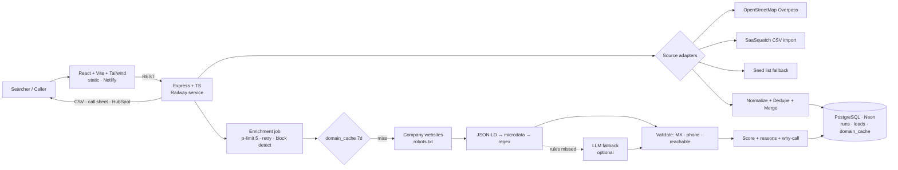

# Spec: SellSignal
*Where §15 "Implementation rules" is more specific than an earlier section, §15 applies.*

## 1. The one feature (Quality First)
**An upgraded "AI Company Scoring" for acquisition searchers.**
- **SaaSquatch today:** a keyword-match score (positive/negative keywords on the website).
- **SellSignal:** an **Acquisition Readiness Score** (0–100, tiers A/B/C) built on **seller-side signals**, with **evidence for every point** and a **"why call" line** for callers.
- Enrichment, dedupe and validation are *how* the score becomes accurate. They are not separate features.

**Why (observed on SaaSquatch's free tier):** most enriched fields came back N/A, revenue estimation failed ("All Gemini models failed"), owner lookup errored, and the score has no "will they sell?" signal. Searchers can't decide who to call first.

**Framing:** complementary and resilient. Rules first, AI as fallback. Every value is traceable. Never "their tool is broken."

## 2. Flow
**Find or import leads → normalize + dedupe → enrich from each company's website → validate → score + reasons + why-call line → ranked results + data-quality report → export (CSV / call sheet / HubSpot CSV)**

User: a searcher, or a Caprae caller working a list.

## 3. Sources (multiple, pluggable `SourceAdapter`)
| # | Source | Role | Status |
|---|---|---|---|
| 1 | **OpenStreetMap Overpass API** (free, no key) | Discovery by trade + area, e.g. `craft=hvac\|plumber\|electrician` in a state | ✅ **Verified at the time of writing:** server-side POST with a User-Agent returned 50 TX HVAC/plumbing/electrician businesses with name, website, phone (browser GET gave 406/CORS; irrelevant for the backend). Mirror fallback: `overpass.kumi.systems`. |
| 2 | **CSV import** (SaaSquatch's exact export columns) | Plug into their workflow | ✅ schema known |
| 3 | **Company websites** | Enrichment | ✅ |
| fallback | **Seed list** | If OSM fails: about 40 real HVAC/plumbing domains hand-picked from an OpenStreetMap snapshot, labeled as such | — |

Demo data: OSM results + a small **labeled synthetic** SaaSquatch-format CSV that overlaps them, so cross-source duplicates are real.

## 4. Scope
**Must:** 1 discovery source (OSM or seed list) + CSV import · normalize/dedupe/merge · website enrichment with per-field source · validation · score + reasons + why-call line · results UI with filters · data-quality report · CSV export.
**Should:** call-sheet export · HubSpot CSV · buy-box editing · row drawer.
**Should (cut first):** AI fallback: one LLM call when rules miss → `{ownerName, foundedYear, familyOwned}`. Cached, behind `AI_FALLBACK=on`.
**Won't (README future work):** headless browser for JS sites, proxies/CAPTCHA bypass, auth, live CRM API, queue workers, email generator / maps (they already claim these).

**Cut order:** AI fallback → HubSpot → buy-box editing → drawer.
**Never cut:** discovery/import, dedupe, enrichment, score + reasons, data-quality report.

## 5. Enrichment (max 3 pages per site: `/`, `/about*`, `/contact*`)
Layered extraction, in order: **JSON-LD (schema.org LocalBusiness/Organization) → microdata → regex/keywords**, so the tool survives site changes.
| Field | Signals |
|---|---|
| yearFounded | `foundingDate`; `(since\|established\|est\.?\|founded(?: in)?)\s*((19\|20)\d{2})` |
| phone / email | `tel:` / `mailto:` links, JSON-LD, regex |
| address | JSON-LD `PostalAddress` |
| ownerName | JSON-LD `founder`; text near owner/founder/president |
| familyOwned | family-owned, locally owned, owner-operated, "generation" |
| alreadyOwned (−) | franchise, subsidiary of, portfolio company, acquired by |
| nonprofit/public (−) | `.gov/.edu`, non-profit, 501(c) |
| digital maturity | © year, HTTPS, viewport meta |

**Robustness and ethics:** robots.txt checked · identifiable User-Agent · 8 s timeout · 1 retry with backoff · max 5 concurrent, 1 per domain · **block/CAPTCHA detection** (403/429, "captcha", "cf-challenge") → mark `blocked`, never bypass · cache per domain for 7 days · public business pages only.

## 6. Score (transparent defaults = the buy-box)
| Signal | Pts |
|---|---|
| Age ≥ 20 y / 10–19 y | +20 / +10 |
| Family-owned / owner-operated | +15 |
| Industry in buy-box | +15 |
| Owner name found | +10 |
| Valid phone / valid email (MX) | +10 / +10 |
| Under-digitized (© ≤ 2021 or no viewport/HTTPS) | +10 |
| State in buy-box | +5 |
| Franchise / subsidiary / PE-owned | −30 |
| Nonprofit / public | −40 |
| Unreachable / blocked | flag only |

Clamp 0–100 · **A ≥ 70 · B 45–69 · C < 45** · each point = a reason chip with its source.
**Why-call line (template, no LLM):** e.g. "Est. 1987 (38 yrs) · family-owned · owner J. Smith → succession angle."
README: these are proxies, not predictions.

## 7. Dedupe and validation
- Normalize: domain (strip protocol/`www`/path), phone (10-digit US), name (lowercase, strip LLC/Inc/Co/punctuation).
- Duplicate if same domain OR same phone OR same name + city → keep the most complete row, fill its gaps, record `mergedFrom` + sources.
- Validate: email syntax + MX · phone format · site reachable · state code.

## 8. Data-quality report (automated reporting)
Rows in (per source) → duplicates merged → unique · field completeness **before % → after %** · sites reachable / blocked / robots-disallowed · A/B/C counts · most common signals. All measured live.

## 9. Stack and hosting
- **Frontend:** React + Vite + TS + **Tailwind CSS** (implementing the Claude Design output) → static on **Netlify**. Responsive (mobile → desktop).
- **API:** Node + Express + TS → long-running service on **Railway**. (Serverless times out on multi-minute enrichment jobs; Render's free tier sleeps and kills background jobs.)
- **DB:** PostgreSQL on **Neon** (serverless Postgres; the API connects with the direct, unpooled URL over TLS). Cache = `domain_cache` table in Postgres, 7-day TTL. **No Redis in v1** (one less service). Scale path: Redis + BullMQ workers.
- **Libraries:** `csv-parse`, `cheerio`, `undici`, `p-limit`, `robots-parser`, `dns/promises`, `pg`. AI fallback: Gemini or Claude API (provider chosen by `AI_PROVIDER`).

## 10. Data model
```
runs(id, source_type, params jsonb, status, stats jsonb, buybox jsonb, created_at)
leads(id, run_id, source, raw jsonb, company, domain, phone, email, street, city, state,
      industry, year_founded, owner_name, signals jsonb, field_sources jsonb, validation jsonb,
      completeness_before int, completeness_after int, score int, tier text, reasons jsonb,
      why_call text, merged_from jsonb)
domain_cache(domain pk, data jsonb, status, fetched_at)
```

## 11. API
| Method | Route | Does |
|---|---|---|
| POST | `/api/runs/discover` | `{trade, state}` → OSM (or seed list) → start job |
| POST | `/api/runs/import` | multipart CSV → start job |
| GET | `/api/runs/:id` | status, progress, report stats |
| GET | `/api/runs/:id/leads?tier=&hasPhone=&hasOwner=&state=&sort=` | ranked leads |
| PUT | `/api/runs/:id/buybox` | rescore (no refetch) |
| GET | `/api/runs/:id/export?format=csv\|callsheet\|hubspot` | download |

Job: in-process, `p-limit(5)`, progress written to `runs.stats`, frontend polls every 2 s.

## 12. UI (Tailwind, from Claude Design; dark + light, responsive; tier colors A green / B amber / C grey)
1. **Start:** two tabs, "Find leads" (trade + state) and "Import SaaSquatch CSV" (plus "use sample").
2. **Processing:** progress bar + live counters (merged, fields filled, blocked).
3. **Results:** report cards (rows → unique, completeness before → after, A/B/C) · quick filters (tier, has phone, has owner, state) · ranked table (tier badge, score, company, age, owner, phone/email ✓/✗, top 3 reason chips, why-call line; filled cells highlighted, source on hover) · export menu.

## 13. Architecture diagram


## 14. Known risks and limitations
1. **No revenue/size signal.** Caprae targets $5–25M revenue; many OSM trade businesses are tiny. We don't estimate revenue. State this in the README. Cheap optional extra: size phrases ("team of 40 technicians", "3 locations", "fleet of 20 trucks").
2. **Owner names will be found rarely.** Regex extraction is unreliable, so expect a low fill rate. This is where the AI fallback earns its place. Report the real fill rate.
3. **Copyright year is weak.** Site builders often auto-update it. Keep it at +10 and call it a hint, not proof.
4. **Founded-year regex can misfire** ("since 2020 we've expanded…"). Accept 1900–current year only. Unit-test with real HTML fixtures.
5. **MX check ≠ verified inbox.** It only proves the domain accepts mail. Label it "domain accepts email", never "verified email".
6. **Render free tier sleeps** after ~15 min idle, which kills background jobs and gives slow cold starts. **Host the API on Railway** (always on) instead.
7. **CSV quirks.** Treat `N/A`, `NaN`, and empty as missing. Match headers case-insensitively with aliases (`Company Phone` ↔ `companyPhone`).
8. **Demo size.** Keep live runs to 25–50 companies so a run finishes in 1–2 min (and fits a demo video).
9. **OSM data quality varies.** Some `website` tags point to location subpages (e.g. `/location/Plano`) or chains/franchises. Normalize to the root domain, and let the franchise/subsidiary signal catch chains.
10. **The database sleeps when idle.** Neon's free tier suspends compute after a few idle minutes; the first query after that takes a second or two longer. The connection timeout allows for it.
11. **High-latency connections.** Node gives each IPv4/IPv6 address only 250 ms to connect by default, which is less than the round trip to a distant database or website; the server raises this to 2 s at startup.
12. **The background job is the riskiest part.** If in-process jobs + progress polling prove unreliable, process in small synchronous batches and drop polling.

## 15. Implementation rules
These rules refine the sections above. Where they are more specific, they apply.

### 15.1 Data handling
| # | Rule |
|---|---|
| R1 | `N/A`, `NaN`, `null`, `-` and empty/whitespace values (any case) count as **missing**. |
| R2 | CSV headers match **case-insensitively, with aliases**: company = `company`, `company name`, `name`, `business name` · website = `website`, `url`, `domain`, `company website` · phone = `companyPhone`, `company phone`, `phone`, `phone number` · email = `email`, `company email` · street = `street`, `address` · state = `state`, `state/region` · year founded = `yearFounded`, `year founded`, `founded` · plus `city`, `industry`. Unknown columns are kept in `raw`. A file without a company column is rejected with a clear error. |
| R3 | Website URLs (OSM `website` / `contact:website`, CSV) are normalized to the **root domain**: lowercase, no protocol, no `www`, no path or query (`https://texassolarpowersystems.com/location/Plano` → `texassolarpowersystems.com`). Social and map hosts are not company domains. Phones become 10 US digits; names are lowercased with LLC/Inc/Co/Corp/Ltd and punctuation stripped (for matching only); states become 2-letter codes. |
| R4 | Run size: discovery returns at most **40** companies; CSV import accepts at most **200** rows, with a warning above 50. Recommended demo size is 25–50 companies. |
| R5 | A founding year is accepted only if **1900 ≤ year ≤ current year**. In page text the **earliest** valid "since / established / est. / founded (in)" year wins, and years on the © line are ignored. |
| R6 | Company size and revenue are **not estimated** (out of scope) and are shown as "not estimated" in the UI and in exports. |
| R7 | The MX check is labelled **"domain accepts email"**, never "verified". It only proves the email's domain can receive mail. |
| R8 | **Completeness** = share of 8 key fields that are filled: phone, email, website, street, city, state, year founded, owner name. "Before" is measured after normalize + merge, "after" after enrichment. |

### 15.2 Trades (OpenStreetMap tags)
Each trade was checked with a live Overpass count (Texas, businesses with a website, at the time of writing):

| Trade | OSM tag | TX results with a website | Kept |
|---|---|---|---|
| HVAC | `craft=hvac` | 132 | ✅ |
| Plumbing | `craft=plumber` | 74 | ✅ |
| Electrical | `craft=electrician` | 35 | ✅ |
| Roofing | `craft=roofer` | 109 | ✅ |
| Landscaping | `craft=gardener` (`craft=landscaper` returned 0) | 20 | ❌ too few |
| Pest control | `craft=` / `office=` / `shop=pest_control` | ~16 combined | ❌ too few |

**Supported trades: HVAC · Plumbing · Electrical · Roofing.** As a cross-check, Florida returned 296 results for the four kept trades combined. Coverage still varies by state, so the UI shows the real count and an empty state when a search finds nothing.
The public Overpass endpoint returned 502s or timeouts on roughly 40% of calls during the check, so discovery uses **1 retry → mirror (`overpass.kumi.systems`) → seed list** (Texas only, with a visible notice).

### 15.3 Sources and demo data
- **Seed list:** about 40 real HVAC/plumbing/electrical domains hand-picked from an OpenStreetMap snapshot of Texas, excluding suppliers and utilities. Labelled as such wherever it's shown.
- **Sample data:** "Use sample file" imports a small **synthetic** CSV in SaaSquatch's export format **together with the seed list** as one run. Some synthetic rows overlap seed companies (same domain, same phone in another format, or same name + city), so cross-source duplicates are real. The synthetic file is labelled in the file and in the README.
- **Default buy-box:** industries = all four supported trades; states = the searched state (discovery) or every state present in the file (CSV import). It can be edited per run, which rescores without refetching.

### 15.4 Score: exact defaults
No baseline points: every point comes from one of these signals.

| Key | Signal | Points |
|---|---|---|
| `age20` | Founded ≥ 20 years ago (current year − founding year) | +20 |
| `age10` | Founded 10–19 years ago (only if `age20` didn't fire) | +10 |
| `familyOwned` | "family-owned", "locally owned", "owner-operated", "Nth generation" | +15 |
| `industry` | Trade is in the buy-box | +15 |
| `owner` | Owner name found | +10 |
| `phone` | Valid US phone (10 digits; area code and exchange don't start with 0 or 1) | +10 |
| `emailDomain` | Email's domain accepts email (has MX records) | +10 |
| `underDigitized` | © year ≤ 2021, **or** no viewport meta, **or** no HTTPS | +10 |
| `state` | State is in the buy-box | +5 |
| `franchise` | Franchise / subsidiary / PE- or portfolio-owned / "acquired by" | −30 |
| `nonprofit` | Nonprofit / public (`.gov`, `.edu`, "non-profit", "501(c)") | −40 |
| `siteIssue` | Site unreachable, blocked, or disallowed by robots.txt | 0 (shown as a flag) |

The total is clamped to 0–100. **Tier A ≥ 70 · B 45–69 · C < 45.** **Not-a-fit cap:** a lead with a franchise/PE or nonprofit signal is tier C whatever its score, so it never reaches the call sheet. Besides website wording, a company name matching a known franchise brand (Benjamin Franklin Plumbing, Mr. Rooter, Roto-Rooter, One Hour Heating & Air, Mister Sparky, Aire Serv, ARS / Rescue Rooter, Service Experts, Mr. Electric, Kinetico, Culligan) counts as the franchise signal, with evidence "name matches a known franchise brand" and source "brand list". Weights can be overridden per run (each between −100 and 100). Each fired signal becomes a reason `{key, label, evidence, source, points}`. The UI shows the top 3 by |points|, and the full breakdown on demand.

**Why-call line (template):** fragments in order: "Family-owned" / "Est." + "since {year} ({n} yrs)" · "owner {F. Last}" · "{ST} {trade}" · "dated website" → angle: "succession" if age ≥ 20 or family-owned, "modernization" if under-digitized. Then "Owner not listed: ask for the owner." when no owner was found. Negative signals produce "Likely not a fit: {franchise/PE-owned | nonprofit}". No signals produce "Limited public info: verify basics on the call."

**Worked example.** *Smith Plumbing*, Dallas TX: "family-owned since 1985" on the site, `© 2019` footer, valid phone and an email whose domain has MX records, no owner name, no franchise or nonprofit signals; buy-box = plumbing + TX. In 2026: +20 (41 yrs) +15 family +15 industry +10 phone +10 email domain +10 under-digitized +5 state = **85 → tier A**. Why-call: *"Family-owned since 1985 (41 yrs) · TX plumbing · dated website → succession + modernization angle. Owner not listed: ask for the owner."*

### 15.5 Exports
Exports apply the same filters as the results list, so the exported rows match the rows on screen.

| Format | File | Columns |
|---|---|---|
| CSV | `sellsignal-leads.csv` | company, website, domain, phone, phone_valid, email, email_domain_accepts_mail, street, city, state, industry, year_founded, years_in_business, owner_name, owner_role, family_owned, franchise_or_pe, nonprofit, size (`not estimated`), revenue (`not estimated`), score, tier, top_reasons, why_call, site_status, sources, merged_from, completeness_before, completeness_after |
| Call sheet | `sellsignal-callsheet.csv` | **Tiers A + B only**, ranked: rank, tier, score, company, phone, owner_name ("(founder)" when the name is a founder; "ask for owner" when none), city, state, why_call, outcome, notes, follow_up_date (the last three empty, for the caller) |
| HubSpot | `sellsignal-hubspot.csv` | HubSpot **Company** properties only, using HubSpot's default property labels: Company name, Company domain name, Website URL, Phone number, Street address, City, State/Region, Industry, Year founded, Description. Industry is a HubSpot dropdown, so the four trades map to its "Construction" option and the trade is named in Description (= "SellSignal {tier} {score} · {trade} · {why_call}"). |

### 15.6 API additions
Beyond §11: `GET /api/health` (API + DB status), `GET /api/meta` (trades, states, limits, default weights), `POST /api/runs/:id/cancel`. Run statuses: `queued`, `running`, `done`, `failed`, `cancelled`. Run IDs are UUIDs. `PUT /buybox` returns 409 while a run is still running.

### 15.7 Crawling details
Pages: `/` plus at most one about-like and one contact-like page found in the homepage links (same host, max 3 pages, sequential per domain). Retry once with backoff on network errors and 5xx only. Blocked responses (403/429, Cloudflare challenge headers, CAPTCHA markers) are never retried. Robots.txt is checked per page with the UA token `SellSignal`. The cache stores extracted facts, not raw HTML. MX lookups time out after 3 s, which counts as "no".

### 15.8 AI fallback (optional, off by default)
- Enabled with `AI_FALLBACK=on`. The default provider is **Gemini**, using the cheapest current Flash-Lite model available to new projects (`gemini-3.1-flash-lite` at the time of writing; overridable with `AI_MODEL`). Anthropic is an optional switch (`AI_PROVIDER=anthropic`, default `claude-haiku-5-5`).
- It runs only when the rules missed the owner name or founding year, with a cap of 25 calls per run, and the result is cached with the domain.
- **Grounding guard:** an AI-suggested owner name is accepted only if it appears verbatim in the page text; a year only if it appears in the text and passes R5. AI-sourced values are labelled as such. Provider errors are skipped, so the rules-only result always stands.
